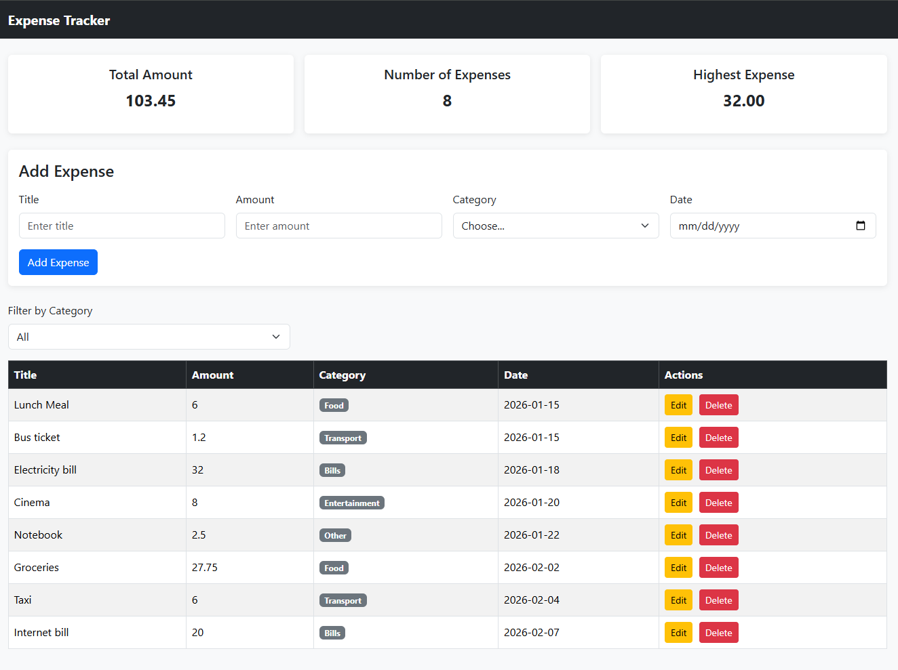
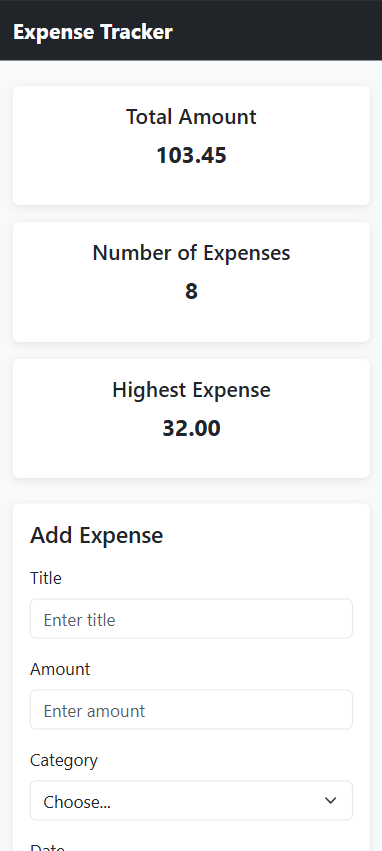
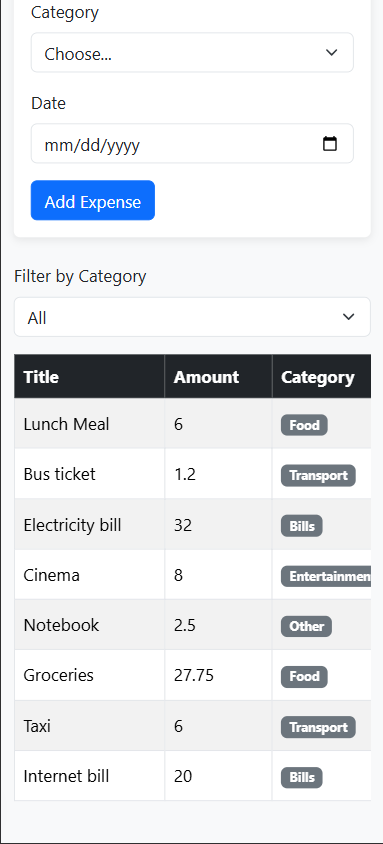
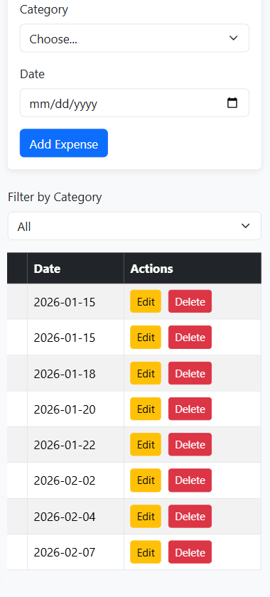

# Expense Tracker

Expense Tracker is a full-stack web application for managing personal expenses.
It allows users to add, edit, delete, and filter expenses while displaying a summary of the total amount, number of expenses, and highest expense.

## How to run

### Backend

1. Open PostgreSQL or pgAdmin.

2. Create a new database named:

   expense_tracker

3. Open the `schema.sql` file inside the `backend` folder and run it on the `expense_tracker` database.

4. Inside the `backend` folder, create a new file named:

   .env

5. Add your PostgreSQL connection information to the `.env` file:

   DB_HOST=localhost
   DB_PORT=5432
   DB_USER=your_postgresql_user
   DB_PASSWORD=your_postgresql_password
   DB_NAME=expense_tracker

6. Open the terminal inside the `backend` folder.

7. Install the required packages:

   npm install

8. Start the backend server:

   node server.js

9. Keep the terminal running while using the application.

### Frontend

1. Open the project folder in VS Code.

2. Install the Live Server extension in VS Code.

3. Make sure the backend server is running.

4. Open:

   frontend/index.html

5. Right-click `index.html` and choose:

   Open with Live Server

6. The Expense Tracker application will open in the browser.

## Features

- [x] Add an expense with validation
- [x] Delete an expense
- [x] Edit an expense
- [x] Filter by category
- [x] Summary cards for total amount, expense count, and highest expense
- [x] Data is saved in a PostgreSQL database
- [x] Bootstrap spinner while loading data
- [x] Bootstrap alerts for errors
- [x] Responsive design for desktop and mobile
- [x] CSS Grid used for the summary cards

## Screenshots

### Desktop View

### Mobile View

### Mobile Table - Left Side

### Mobile Table - Right Side

## What was the hardest part?

The hardest part was keeping the frontend data synchronized with the backend and PostgreSQL database after adding, editing, or deleting an expense.

I solved this by sending the required POST, PUT, or DELETE request using fetch and async/await, and then requesting the expenses again from the server using GET. This makes sure that the table and summary cards always display the data that is actually saved in the database.